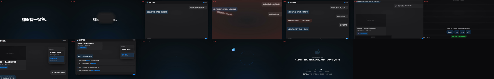

# 🐋 蓝色大肥鱼 · QQ 群机器人

> 一个跑在云服务器上的 QQ 群聊 AI 机器人。**自研，零第三方依赖** —— 只需要 Node 22+（图片压缩/封面比对会借用服务器现成的 Pillow，不是 npm 包）。
>
> 不是框架、不是现成软件，是手写的完整链路：**鉴权 → 长连接 → 事件分发 → 分层决策 → 模型调用 → 限流 → 发送 → 容错**。

[](promo/bigfish-promo.mp4)

> 🎬 **32 秒宣传片** —— [点这里观看](promo/bigfish-promo.mp4)（成片 MP4，GitHub 网页上直接播放；源文件、渲染脚本与第一版归档都在 [`promo/`](promo/)）

---

## 它是什么

在 QQ 群里像一个**有性格的群成员**那样聊天，而不是一个"问答接口"。

| 特点 | 说明 |
|---|---|
| **拟人** | 甜系傲娇的「鲸鱼娘」人设，会吐槽、会得意、会用括号写动作 |
| **有分寸** | 不该说话时**真的沉默** —— 别人互相 @、机器人不抢答 |
| **听指挥** | 群指令 `#cd`（菜单）/ `#tg`（投稿）/ `#js`（视频解析）；主人 @它说「关机 / 开机」才闭嘴或回来 |
| **看得懂链接** | 群里贴 GitHub / B站 / 抖音 / 快手，自动回一张信息卡片；**B站 / 快手 / 抖音都连视频本体一起发**（抖音那条是**无水印**源，只发 60 秒以内的）；**B站 App 分享过来的「小程序卡片」也认** —— 那种卡片里没有链接，靠标题反查回视频，**同名多条时再用封面 dHash 锁定原视频** |
| **看得懂图** | 图片和表情包会被认出来变成一句话，**连"谐音梗"都读得懂** |
| **听话** | 主人 @它说「关机」就闭嘴，「开机」再回来 —— **全局生效** |
| **记得住** | 最近 30 条 / 10 分钟 / 800 字内的上下文，冷场后自动忘记旧话题（**只保留会话内短期上下文，不落盘长期记忆**） |
| **花钱有上限** | 每天 ¥3、总计 ¥50，超了自己在群里喊"没钱了"（**每个群每天只喊一次**，不刷屏） |
| **会配图** | 自带**图库**：网页控制台传图 → AI 逐张说理解 → 点「用」才入库；之后它会在合适时机自己配图（**主动配图按 33% 概率抽签**，不刷屏；**它自己配的图不占群冷却，只有群友点名要的才占**） |
| **群友能投稿** | 群里**引用一张图** + 发 `#tg` → 进图库「待确认」等你点「用」（按群 5 分钟冷却；主人免冷却） |
| **会复读** | 群里出现**连续两条一模一样**的消息时，跟着读一遍（0 次模型调用） |
| **可观测** | 自带**七页网页控制台**（概览 / 对话 / 设置 / 图库 / **梗库** / **直发** / 日志），**左侧图标轨道 + 紧凑工作台布局**；**直发页可以「以机器人身份」往指定群发消息、并一键撤回**；**梗库会自己从群聊里学梗（纯代码统计频次，攒够 40 条消息、间隔 ≥10 分钟才批量问一次模型，命中才注入一句提示、平时不占 token）；面板只负责改错/停用/删除，不用手动新增；固定暗号可要求原样接，普通梗可写多个接法，还能配「镜像替换」：把它原话里的某个字换掉再原样回去（代码直回、不调模型）**；手机就能看，**深浅双主题** |

---

## 功能

### 群内指令（前缀只认 `#` / `＃`）

| 指令 | 作用 |
|---|---|
| `#cd` | 功能菜单（卡片**一行一个功能**） |
| `#tg` | 投稿图库：**先发一张图 → 引用它 → 发 `#tg`**（**只认引用**；按群 5 分钟冷却，主人免冷却） |
| `#js` | 视频解析（本来就是**免 @ 自动采集**；这行只是写进菜单让人知道） |

> 另外：主人 @它说「关机 / 开机」；`#cd` 看功能菜单。

### 对话与人格

- **示例对话驱动语气** —— 把示例作为**真实的多轮消息**传给模型（不是写在提示词里的文本），
  模型看到的是"自己以前这么说过话"，模仿效果远强于规则说明
- **提示词可切换** —— `lean`（**839 字**，默认）/ `full`（**1254 字**）两套在代码里，改一个词即可回退；线上当前生效的是面板人设 **1682 字**（字数 2026-10-18 实测）
- **人设在线可改 + 预设卡片** —— 网页控制台里直接改人设提示词与语气示范，还能把"整套性格"存成预设卡片，**点一下整套切换，立刻生效、不用重启**；代码里那份默认人设只是出厂值
- **反重复机制** —— 把它最近说过的 5 句话回灌进提示词，要求"换个说法"，
  避免反复被挑衅时永远回同一句
- **多行分段发送** —— 超 40 字按句末标点切分，段间 0.8~1.8 秒**随机**间隔（固定间隔像机器）
- **半角括号写动作** —— `(尾鳍啪地甩过来)`，一条消息最多一个，只在情绪明显时用

### ⭐ 链接自动解析（**无需 @**）

群里贴链接就自动回一张信息卡片，**全程不调模型**（模板拼接）→ **零成本，且天然免疫提示注入**。

| 平台 | 卡片 | 视频本体 | 备注 |
|---|---|---|---|
| **GitHub** | ✅ | — | 含仓库预览图（走**自建中转**，见下） |
| **B站** | ✅ | ✅ 360P | 直链有防盗链，必须带 `Referer` 自己下载再转存 |
| **B站卡片** | ✅ | ✅ 360P | 从 B站 App 分享到群里的「小程序卡片」**里面没有链接**（平台只给标题+封面），靠**拿标题去 B站搜完全同名的那条**反查回视频；**同名多条时再用封面 dHash 比对挑同一张封面的那条**；**卡片不再发数据卡片，直接「正在解析」提示 + 发视频**；实测 92 张真实卡片召回 **90%**，搜不到就安静落回正常聊天 |
| **抖音** | ✅ | ✅ **无水印** | 起无头浏览器打开 PC 视频页，用 CDP 接回带 `a_bogus` 签名的 detail 响应（约 17 秒；那个签名只能由页面 JS 现算，纯 HTTP 伪造不了）⇒ 拿到的是**无水印直链**。**≤60 秒**的下载后直接发进群，更长的只在卡片留一行直链、不下载 |
| **快手** | ✅ | ✅ | 数据内嵌在分享页 HTML 里 |

**卡片内容**：封面 / 标题 / 作者 / 时长 / 发布日 / 播放·点赞·评论 / 🔗 打开链接。

- **一条消息最多解析 2 个链接**，各发一张卡片（被动回复配额只有 5 条）
- **转发的聊天记录不解析** —— 那里面出现链接往往只是"记录里的内容"，不是有人在这个群里分享
- **同一条链接 10 分钟内不重复发**（防刷屏、防"引用自己的卡片"被二次解析）
- **去重按"指向什么"算**，不按 URL —— 3 个指向同一仓库的 issue 链接只发 1 张卡
- **封面按真实宽高比渲染**（竖屏不会被压扁）

> 📌 **GitHub 预览图为什么要自建中转**：官方文档写明 markdown 里的图片由
> 「**开放平台下载转存**」—— QQ 只在**发卡片那一刻**抓一次，抓失败**不重试**，
> 那张卡就永远没图了。而 `opengraph.githubassets.com` 会**间歇性 429**。
> 所以改成"**我们先把图抓进缓存，再发卡片**"，QQ 来抓时必定命中。
> 详见 [项目文档 · 16.3.1.1](docs/项目文档.md)。

### ⭐ 识图（图片 / 表情包）

有人发图，机器人**先把它变成一句中文描述**，再当作"这条消息说了什么"接进正常对话流程。

```
群友发「熊猫头憋笑」 → 【图片】强行憋笑、嘴角上扬的魔性表情，配文字"憋笑"
群友发「流泪吃面的猫」→ 【图片】委屈难过到一边流泪一边干饭的反差感
```

- **不用新的 API Key、不用换服务商** —— 现有的 `deepseek-flash` 本身就支持图片输入
- **成本约 ¥0.0004/张**（一张 ≈ 286 token，一次正常回话 ≈ 900 token）
- **同一张图 24 小时内只算一次**（按内容 md5 去重，实测群里图片重复率 28.6%）
- 限额：**每天 800 张**（**网页控制台里可调，保存即生效**，不用重启）/ 同群 2 秒冷却 / 单图 8MB
- 没看成的时候**不允许它编理由**：名额用完 / 取图失败等情况由代码给一句固定说明，并落盘留痕

**它什么时候会回你**：

| 场景 | 会回吗 |
|---|---|
| **@它 + 表情包** | ✅ 会，而且认得图 |
| 主人发图 / 图旁边有触发词 | ✅ 会 |
| **只发一张图、没 @ 它** | ❌ 不回（但描述已进上下文，之后问"刚那图啥意思"它能答） |

### ⭐ 开关机（全局 + 单群）

| 想做什么 | 怎么做 |
|---|---|
| **关掉某一个群** | 在**那个群**里 **@它**，发「关机」 |
| **打开某一个群** | 在**那个群**里 **@它**，发「开机」 |
| **一次管所有群** | 网页控制台 → 概览 → 「开关机（全局）」的开机 / 关机按钮 |
| **在对话页点某个群** | 网页控制台 → 对话 → 群卡片右上角的「关本群 / 开本群」 |
| 私聊 | 不用 @；私聊里的开关机作用于**全局** |

> 只认 **「开机」「关机」** 两个词。`开启 / 启动 / 醒来 / 关闭 / 停止 / 睡吧` 等**近义词一律不触发** —— 宁可漏判，绝不误关。

**语义**：单群设置**优先**；面板的全局按钮是**批量覆盖** —— 点一次会把所有群的单独状态清掉、统一成开或关。
**关掉之后**：不回话、不解析链接、不识别图片 —— 一分钱都不花。
防误触三道：**只有主人**能操作 · 群聊**必须 @ 它** · **整句**匹配（「怎么关机啊」不会触发）。

> ⚠️ **忘了开回来**：① 在群里 @它说「开机」 ② 删掉 `data/power.json` 后重启（**连各群的单独设置一起清空**）
> ③ 看网页控制台（关机时顶部有红色横幅）。
> 状态**落盘**（`data/power.json`，含 `groups` 里每个群的单独开关）—— 否则 systemd 一重启"关机"就被悄悄撤销了。

### ⭐ 不知道就说不知道（反编造）

- **知识闸**：被问“像事实”的问题时，生成前多问判断模型一句「你真的知道吗」；判定不知道 ⇒ 只能用玩笑/自嘲语气说不知道，**不许给具体人名、年份、日期、版本号、价格**。
- **回复硬闸**：回复里出现上下文没有的链接 ⇒ 自动替换成「（链接我不确定，别点）」；判定不知道却还冒出具体年份/日期/版本/价格 ⇒ 整条换成固定话术。
- **代码直答**：日期 / 时间、以及“用什么模型”（仅 `truth` 模式）这类有唯一答案的问题由代码回答，不交给模型 —— 同一个问题问两次不会给出两个答案。
- **默认人设优先**：被问身份 / 模型时按人设回答（不戳破角色）；需要真话时把 `.env` 的 `SELF_MODEL_ANSWER_MODE=truth` 再重启。
- **反重复只管措辞**：换说法、换梗、换语气可以；日期、数字、结论这类事实**必须与上面一致**，事实类问题干脆不参与反重复。

### ⭐ 网页控制台（手机可看，五页）

| 页 | 能做什么 |
|---|---|
| **概览** | 全局开关机（**批量覆盖所有群**）· 今日额度与累计花费 · **用量趋势柱状图**（7 / 14 / 30 天，柱高按本批最大值等比，一眼可比高低） |
| **对话** | 最近的群 / 私聊对话卡片（谁说了什么、它怎么回的）；**群卡片右上角可直接「关本群 / 开本群」** |
| **设置** | **在线改人设 + 语气示范**、额度、每日次数上限、图库概率、**群友投稿开关**（关掉后 `#tg` 当普通聊天）、**插嘴开关**（关掉后没 @ 它就完全不主动说话）、**插嘴概率**（没 @ 没关键词时主动接话的概率，0~1）、**梗库自动学习**开关、**对话模型（V4.1 Flash / V4-Pro）**、**思考强度（关 / 低 / 高 / 最高）**、**DeepSeek API Key**（保存前会实连一次校验）；人设/额度等**即时生效**，密钥、模型与思考强度走 `.env`、改完点「重启机器人」（思考**等级**固定 auto：**能算出唯一答案的才开**——长数字/二进制/算式/换算/解码；开放问题和闲聊不开，L1 判断永不开） |
| **图库** | 上传图片 → AI 逐张说理解 → 点「用」才入库；**`#tg` 群友投稿**落在同一页的「待确认」区，由你点「用 / 弃」 |
| **日志** | 实时原始日志（排查用） |

外加两个顺手的东西：

- **试聊**（`/api/sandbox`）—— 用**实时读取的当前人设 + 示范**生成一条回复给你看，**不发群**；
  代价是它**花真钱**（真的调一次模型）。
- **人设预设** —— 把"整套性格（人设 + 示范）"存成卡片，**点卡片 = 立刻整套切换**。

> 🎨 界面是**深浅双主题**（跟随系统 / 强制浅色 / 强制深色），首屏有内联脚本先定主题，
> **刷新不闪白也不闪黑**；手动选过就永远听你的，没选过才跟随系统。

### ⭐ 情绪观察

- **情绪观察器**（`emotion.js`）—— 26 类 / 240 词的本地词典，纯正则统计，
  **只观察、不进提示词**（不影响模型说什么，是给日志和后续分析用的），可一键关掉。
- **不保留长期记忆**：2026-10-20 按用户要求移除了「记住」便签本（`memory.js`）——
  只有会话内短期上下文，不落盘、不跨会话。

### 什么时候会说话

| 场景 | 行为 |
|---|---|
| **@它 + 有内容** | ✅ 一定回 |
| **@它 + 没写字** | ✅ 回一句「咋了」这类 |
| **@别人** | ❌ **不抢答** |
| 没 @人 + 提到关键词（大肥鱼/蓝鲸…） | ⚠️ **50% 概率**，且**引用原消息** |
| 没 @人 + 没关键词 | ⚠️ 看运气：**8% 概率**被搭话（2026-10-05 起，原为 0%） |
| **私聊** | ✅ 一定回 |

**"刹车"清单**：同人 60 秒冷却 · 同群 3 分钟最多 2 次 · 太短（<4 字）不理 ·
每天最多 **3000 次**调用（面板可改，代码默认 1600） · 双预算（¥3/天、¥50 总额） · **闲聊搭话概率 8%**（没 @ 也没提关键词时） · **@ 限流：同一内容反复发才会挡**（判据是"重复"不是"频繁"，正常话密不受影响）。
（深夜静默 2~7 点**已关闭** —— 配置项留着，改回 `true` 就恢复。）

---

## 架构

```
                    QQ 开放平台
                         │  WebSocket（官方 API v2，intents = 1<<25）
                         ▼
   ┌──────────────────────────────────────────────┐
   │  gateway.js    长连接 · 心跳 · 断线指数退避重连 │
   │  auth.js       AccessToken 获取与缓存          │
   └──────────────────────┬───────────────────────┘
                          ▼
   ┌──────────────────────────────────────────────┐
   │  index.js      事件分发 · 去重 · 预算拦截 · 发送│
   │                                                │
   │   ⓪ power.js      本群/全局开关机？关着就直接 return │
   │   ① vision.js     有图？→ 先变成一句可读文本     │
   │   ② linkparse.js  有链接？→ 发卡片（+ 视频）     │
   │   ③ 都不是 → 走下面的正常对话流程                │
   └──────────────────────┬───────────────────────┘
                          ▼
   ┌──────────────────────────────────────────────┐
   │  brain.js      ┌─ L0 硬规则（纯正则，不花钱）  │
   │                ├─ L1 判断（小模型：该不该接话） │
   │                └─ L2 生成（人设 + 上下文 + 分段）│
   └──────────────────────┬───────────────────────┘
              ┌───────────┴───────────┐
              ▼                       ▼
   ┌──────────────────┐   ┌──────────────────────┐
   │  budget.js       │   │  qqapi.js            │
   │  双预算 + 按量计价 │   │  发送 · 错误码翻译 · 重试│
   └──────────────────┘   └──────────────────────┘

   支撑模块：
     qqmedia.js        富媒体分片上传（视频 / 图片）
     power.js          全局 + 单群开关机（状态落盘）
     sendqueue.js      按会话串行发送（防两人同时提问把回复交叉）
     emotion.js        情绪观察器（26 类 / 240 词，只观察不注入，可一键关）
     settings.js       面板可改参数（白名单校验 + 原子写 + 改前备份）
     examples.js       语气示范（作为真实多轮消息喂给模型）
     presets.js        人设预设（整套人设 + 示范存成卡片）
     usage.js          每日用量（趋势图的数据源）
     gif.js            纯 JS GIF 解码（多帧拼网格）
     tools/logweb.js   网页控制台（页面 + HTTP 接口）
     tools/ogcache.js  GitHub 预览图中转缓存
     tools/convo.js    对话记录解析（对话页的数据源）
     tools/ops/        凭证轮换 · 线上体检
```

> 🧠 `emotion.js` 是**旁路**：纯本地词典，**只观察、不进提示词**，不改上面的决策顺序。

**设计原则**：**能不用模型解决的，就不用模型。**
L0 全是纯正则（长度、冷却、@ 判定、静默时段），**零成本**；
只有真正需要语义判断的才交给 L1；L2 只负责"怎么说"。

> ⚠️ **为什么 ⓪①② 必须在 L0 之前**：
> 关机要真的是"什么都不做"（放晚了那一步的钱已经花掉了）；
> 而链接/识图是"无需 @"就要生效的，L0 里"没 @ 没关键词一律不理"会把它们全拦掉。
> 代价是自己管护栏（冷却 / 每日上限 / 连发上限）。

---

## 成本（实测）

| 项 | 实测值 |
|---|---|
| 每天 | 约 **1170 次调用**（2026-10-12~18 共 8211 次 / 7 天） |
| 账本 | **¥1.64/天 ≈ ¥49/月**（同期 ¥11.48；随群活跃度浮动，面板「用量」能看到实时数） |
| **链接解析** | **0 次模型调用**（模板拼卡片） |
| **识图** | 约 **¥0.0004/张**，同图 24h 内只算一次 |

**两个关键结论**：

1. **97% 的 token 是"输入"，不是"输出"** → 优化全盯输入。
2. **提示词缓存是最大的省钱杠杆** —— 缓存命中价是未命中的 **1/50**。
   ⚠️ 所以**凡是会变的东西（时间、随机数）一律放 `user`，别放 `system`** ——
   把时间放 system 末尾，会让整个前缀**每分钟失效一次**（实测命中率 0% → 挪位后稳定 53%）。

> ⚠️ **`totalLimitYuan` 是硬停**：累计到了就拒绝所有调用，并在群里说"没钱了"。
> 现在是 **¥50**（2026-10-01 ¥10 → ¥20，2026-10-05 ¥30，2026-10-18 ¥50）。
> 它已经**降级成兜底** —— 真正准的那道闸是**官方余额**（本地账本和官方对过账，
> 差过 ¥1.5，所以"还剩多少钱"只信官方）。
>
> 🔴 **别让"没钱了"变成刷屏**：撞上限之后它是**每个群每天最多说一次**的。
> 早期版本没有节流，24 小时发了 **285 次**，把群刷了。
> ⇒ 教训：**"要让群里知道原因"是对的，但说一次就够了。**

---

## 快速开始

### 环境

- **Node 22+**（需要全局 `WebSocket`）
- 一台能联网的服务器（本项目在 2核2G / Ubuntu 24.04 上跑）
- 一个 [QQ 机器人](https://q.qq.com) 应用（拿 AppID / AppSecret）
- 一个 **DeepSeek** API Key（面板保存前会实连一次 `/models` 校验；**只接受 DeepSeek 的 key**）。模型二选一：`deepseek-flash`（= V4.1 Flash，默认、能识图）或 `deepseek-v4-pro`（纯文本，**不能识图**）
- 🆕 **`chrome-headless-shell`**（**只有抖音视频需要，可选**）——
  抖音的 `a_bogus` 签名只能由页面 JS 现算，所以取无水印直链要起一个无头浏览器。
  **不装不影响别的功能**，只是抖音"只出卡片、不出视频"。它是**纯二进制、不是 npm 包**，零依赖铁律不破：

  ```bash
  URL=$(node -e "fetch('https://googlechromelabs.github.io/chrome-for-testing/last-known-good-versions-with-downloads.json').then(r=>r.json()).then(j=>console.log(j.channels.Stable.downloads['chrome-headless-shell'].find(x=>x.platform==='linux64').url))")
  curl -fsSL -o /tmp/chs.zip "$URL"
  (unzip -q /tmp/chs.zip -d /opt || python3 -m zipfile -e /tmp/chs.zip /opt/)
  mv /opt/chrome-headless-shell-linux64 /opt/chrome-headless-shell
  ```

  默认路径 `/opt/chrome-headless-shell/chrome-headless-shell`，可用环境变量 **`DY_BROWSER`** 换。
  ⚠️ 两个坑：服务以 root 跑 ⇒ 浏览器**必须带 `--no-sandbox`**（代码里已加）；2G 内存**同时只能开一个** ⇒ 模块里有**串行锁**，别绕过。

### 部署

**服务器上一条命令**（脚本会装 Node、拷代码、自检、生成 `.env` 与两个 systemd 服务）：

```bash
# ① 本地：把整个仓库传到服务器
scp -r .\deploy.sh .\server root@<你的服务器IP>:/root/xiaolanjing-upload/
# ② 服务器：一键部署（会依次问你 AppID / AppSecret / API Key / 日志页密码）
sudo bash /root/xiaolanjing-upload/deploy.sh
```

脚本第 3 步是**整目录拷代码**，第 4 步紧接着跑**部署自检**
（`tools/ops/verify-deploy.cjs`：把每个 `require('./x')` 解析一遍 + 每个文件过一遍 `node --check`），
**少一个文件就红并中止部署** —— 不会再出现"装完了却 `Cannot find module` 起不来"。

> 🆕 2026-10-08 重写。旧版是**手写文件名白名单**：早期漏 `budget.js`、
> 补到 7 个之后**仍然漏着 12 个模块**（实测崩在 `Cannot find module './settings'`）——
> 也就是说"照 README 跑 deploy.sh"从来就不可能成功。**人的记性靠不住，所以改成机器对账。**
> 细节见 [项目文档 15.1](docs/项目文档.md)。

#### 🔴 跑完脚本，还有两件事**只能你本人做**（脚本代替不了）

| # | 做什么 | 不做会怎样 |
|---|---|---|
| ① | **群主**：手机 QQ → 群设置 → 机器人 → 打开「**获取群内全部消息**」 | 机器人**只能看到 @ 它的消息** —— 链接解析 / 识图 / B站卡片这些"不用 @ 也干活"的功能**全废**，而且**不报错** |
| ② | 把自己设成**主人**：先在群里发一句话 → `sudo node /opt/xiaolanjing/tools/ops/find-openid.cjs` → 复制你那串 32 位 ID → 按输出提示写进 `.env` → 重启 | 「只服从主人」的规则**静默失效**（`isOwner()` 永远 false），你查不出为什么 |

> ⚠️ ② 里**不能填 QQ 号** —— QQ 平台只给 `member_openid`，而且这个 ID **按机器人应用隔离**
> （换个机器人，同一个人就是另一串）。这也是为什么必须先跑起来才能知道自己的 ID。

> 📌 服务器上是**扁平布局**（`/opt/xiaolanjing/*.js`），所以在那上面跑自测是
> `cd /opt/xiaolanjing && node test-brain.js`（没有 `server/` 前缀），
> 部署自检是 `node /opt/xiaolanjing/tools/ops/verify-deploy.cjs /opt/xiaolanjing`。

### 🔴 必踩的坑

| 坑 | 症状 | 正解 |
|---|---|---|
| **主人标识填 QQ 号** | 主人规则**静默失效**、无任何报错 | 必须填 `member_openid`（QQ 不提供 QQ 号），用 `tools/ops/find-openid.cjs` 挖 |
| **Windows CRLF 污染 `.env`** | 配置"明明写了"却读成空 | 用 `printf \| sudo tee`，别用 nano 粘贴 |
| **"机器人只看到 @ 消息"** | 某些群不 @ 就不回 | 这是**群主**在**手机 QQ 群设置 → 机器人**里开的「获取群内全部消息」，**不是代码问题** |
| **手动 `node` 读不到 `.env`** | 看到的是默认值，不是线上值 | `.env` 是 systemd 注入的；手动跑要自己先解析 `.env` |
| **只放行 SSH 端口** | 面板打不开 | 机器人本体**不需要任何入站端口**；但面板要用 `8080`，得去云控制台入方向放行 |

### 推送前必跑（如果你要改代码）

```powershell
git add -A
node devtools/audit-remote-sanitize.cjs --staged    # 必须 ✅✅ 脱敏彻底
node devtools/audit-remote-sanitize.cjs --worktree  # 🔴 两道都要跑，见下面的原因
git status --short                                   # 看一眼没混进临时文件
git commit -F 提交信息.txt
git push origin main
git rev-parse HEAD ; git rev-parse origin/main        # 两个值相等才算推上去
```

> 🔴 **为什么脱敏审计必须跑两道**（2026-10-08 真实事故）：
> `--staged` 只看**这次要提交的文件**，所以**看不见仓库里已有的遗留**。
> 那次就是这么漏的 —— `devtools/live-audit.cjs` 和 `live-numbers.cjs` 里
> **硬编码了服务器公网 IP**，它们是**上一次提交**带进去的，
> 于是 `--staged` 一路绿灯，直到事后跑 `--worktree`（扫整个工作区）才把它揪出来。
> 而仓库是**公开**的 ⇒ 已经推上去的内容，事后改文件**补救不了历史**。

---

## 测试

```bash
node server/test-brain.js
```

**1031 项自测**（2026-10-23 实测：1029 通过 / 2 条已知常红），覆盖：

| 组 | 内容 |
|---|---|
| 1–2b | **@ 判定**（只认 `is_you`，含手机走另一条事件）· 非文本消息过滤 · **引用消息**（真机数据） |
| 3–8 | 抽样开关（8%）· 关键词 · 连续上限 · 私聊免闸 · 忽略机器人自己 · 时区静默 |
| 9 | 跨文件一致性（防"改了 A 忘了传 B"） |
| 10 | fetch-stubbed 运行时结构检查（零成本真调用） |
| 11–12 | 多行分段 · **上下文三重约束**（条数/时效/**长度**） |
| 13–14 | **@ 判定** · 不许抢答 |
| 15–17 | 表达丰富度 · 时间感知 |
| 16b | **复读**（连续两条一模一样 → 跟着读一遍，0 次模型调用） |
| 16c | **群友投稿图库**（`#tg` + 引用一张图 → 进后台待确认 · 按群冷却 · 格式不对不回） |
| 16d–16f | **发图前压缩**（图库输出尺寸）· **统一压缩入口**（PNG 走 Node / GIF·JPEG 走 Pillow）· **「为什么不给我图了」两个真 bug** |
| 18 | 模型配置一致性（防跨服务商误配） |
| 19 | **链接解析**（平台识别 / 白名单 / 多链接 / 封面比例 / 去重 / 防自解析 · **B站「小程序卡片」按标题反查 + 同名时封面 dHash 锁定** · **纯离线**） |
| 20 | **识图**（格式嗅探 / 附件提取 / `@`+表情包不被误判 / 去重 / 限流 · **纯离线**） |
| 21 | **开关机**（**全局 + 单群** · 命令识别 / 权限 / 防误触 / 落盘 / **源码顺序锁**） |
| 22 | **预算告知节流**（同一群每天只说一次，跨群独立） |
| 23 | **动图 GIF**（采样多帧拼网格 —— 视觉 API 本来只认第一帧） |
| 24 | **@ 专属限流**（治"**无意义** @ 刷屏"：同一内容 2 分钟内第 3 次起挡，主人免闸；**正常话密不误伤**） |
| 25 | **提示词行为**（不知道就说不知道、**绝不编造**；知道就直说别装傻；知道自己跑在 DeepSeek 上） |
| 26 | **思考**（等级 `auto`/`enabled`/`disabled`，面板**固定 auto**：**算得出唯一答案的才开**（长数字/二进制/算式/换算/解码），开放问题与闲聊不开；强度 `off`/`low`/`high`/`max` 四档，**只在真开思考时才发送**） |
| 27 | **抖音图文**（平台不给 SEO 数据时的降级路径） |
| 28 | **@ 判定第四条证据**（手打的「@机器人名」也算在叫它） |
| 29 | **每日调用上限**（800 → 1600 这次调整要被锁住） |
| 30 | 主人不再免抽样 · 手打的「@别人」不抢答 |
| 31 | 「今日调用次数」的显示口径（终身累计 → 今日） |
| 32 | **情绪观察器**（只观察不注入 · 单字词默认不用 · 自带误报回归） |
| 33 | **官方余额**（"没钱了"的真闸）· 总额度 20 → 30 |
| 34 | **纯寒暄**（早安/晚安）→ 零成本固定应答 |
| 35 | **「刚刚处理过的链接」**进上下文（答偏修复） |
| 36 | **长期记忆已移除**（2026-10-20：不再有便签本 / 不再接线「记住」，只留会话内上下文） |
| 37 | **网页控制台**（对话卡片解析 + 可改参数白名单 / 密钥掩码 / **对话模型下拉** / **单群开关按钮**） |
| 38 | **同群发送排队**（两个人同时问 → 8 条交叉刷出来） |
| 39 | **语气示范**（examples）面板可改（"示范显化"） |
| 41 | **用量趋势**（从日志倒推每日用量） |
| 42 | 处理细节不占"决策"位 · 翻成人话 |
| 43 | **人设预设**（整套人设 + 示范存成卡片，点卡片切换） |

（组号 40 空缺，不复用。）

**每个测试都对应一个真实踩过的 bug** —— 不是为凑数写的。

> 💡 测试做的是**行为验证**而不只是文本检查。
> 例如"时间必须放 user 不能放 system"这条，会去真实请求体里断言 —— 因为放错位置
> 会让提示词缓存命中率从 53% 掉到 0%，而那是个**没有任何报错**的性能损失。

---

## 文档

| 文档 | 内容 |
|---|---|
| [**项目文档**](docs/项目文档.md) | **全部内容都在这一份** —— 目录结构 · 架构与数据流 · 行为规则 · 配置 · 部署 · 运维 · 排错 · **116 条踩坑记录** · 待办 |
| [防提示注入护栏-方案](docs/防提示注入护栏-方案.md) | 尚未施工的安全方案 |
| [关键信息速查.模板](docs/关键信息速查.模板.md) | 占位符版速查表（真实版在本地 `private/`，不进仓库） |

> 📁 **仓库结构**
> `server/` 机器人本体（部署到服务器 `/opt/xiaolanjing/`）· `devtools/` 只在本机跑的工具 · `docs/` 文档
> 本地私有内容（真实凭证、审计特征清单）在 `private/`，已被 `.gitignore` 排除，**不进仓库**。

### 本地验收闸门（`devtools/`，17 个零依赖脚本）

改网页控制台**只看语法过不算数** —— 必须让真浏览器算一遍。分三层：

| 层 | 脚本 | 干什么 |
|---|---|---|
| **本地闸门** | `syntax-check` · `check-page-script` | 逐文件 `node --check`；把页面模板里**每一段** `<script>` 抽出来单独验（还专数"模板里的反引号必须为 0"） |
| | `preview-page` | 渲染成**可直接双击打开**的打样页（接口桩掉、假数据填满每块） |
| | `theme-audit` | 无头浏览器真跑打样页读 `getComputedStyle`，60+ 条断言 × 两套主题（主题落没落、深色是不是灰黑、柱子等宽等比、对比度 AA…） |
| | `btn-probe` · `assert-deliverable` · `shot-page` | **真的去点按钮**再读结果 · 扫渲染后 HTML 的禁用色/原生控件 · 截图（浅深各一张） |
| **上线后体检** | `live-audit` · `live-numbers` · `probe-limits` | 带密码打开**线上真页面**对账 · 把页面上所有数字**全摊出来**逐条比 · 在服务器上用机器人自己的环境读配置对账 |
| **凭证** | `verify-credentials` · `sync-credentials` · `audit-remote-sanitize` | 校验/同步凭证 · **推送前必跑**的脱敏审计 |

---

## 已知限制

| 限制 | 原因 |
|---|---|
| **抖音超长视频不发本体** | 直链是能拿到的，但长视频下载 + 分片上传太费（2核2G / 3M 带宽），所以 **>60 秒的只在卡片最后留一行无水印直链**，不下载不转发 |
| **抖音卡片没有播放量** | 抖音那段数据里根本没这个字段（不是没读到） |
| **检测不到「戳一戳」** | 官方平台**不推**这个事件，也**没有发送它的接口**。证据见项目文档 13.2.1 |
| **一条消息最多解析 2 个链接** | 被动回复配额只有 5 条/条消息，一个链接最多要 3 条 |
| **转发的聊天记录不解析** | 里面的链接往往只是"记录里的内容"，不是有人在这个群里分享（刻意设计，防机器人互相喂消息刷屏） |
| **群里未 @ 时不接陌生话题** | 刻意设计 —— 群聊里最招人烦的是机器人抢答 |
| **改密钥 / 换模型 / 改思考强度需重启** | 面板的人设 / 示范 / 额度 / 次数上限 / 图库概率都**即时生效**；AI API Key、**对话模型**与**思考强度**写 `.env`，得点一下「重启机器人」 |
| **上下文是内存态，重启清空** | 重启后重新观察，合理 |
| **不可真 @ 别人** | QQ 不暴露用户 openid，做不到 |
| **会话历史有限** | 30 条 / 10 分钟 / 800 字；更长的信息靠提示词承载 |
| **私聊不发视频** | 单聊的富媒体上传是另一套端点，没做 |
| **抖音图文链接只有分享文案** | 抖音**不给图文页 SEO 数据**（视频页有、图文页没有），所以图文卡片只有「作者 + 分享文案里的正文」，没有封面/时长/点赞 |
| **2025 年之后的新梗不知道** | 模型的**知识有截止点**（约 2025 年年中）。提示词只能保证它**诚实地说不知道**，不能让它知道 —— 想追上只能"人喂" |

---

## 免责与合规

- 本项目使用 **QQ 官方机器人 API**，**不使用任何第三方外挂或协议破解**
- 请遵守 [QQ 机器人运营规范](https://bot.q.qq.com/wiki/business/)
- 机器人对用户的输出由所接入的模型生成，**请在部署前评估合规风险**
- 凭证管理、内容审核、数据留存由**部署者自行负责**

---

## License

待定 —— 如需使用请先联系作者。
